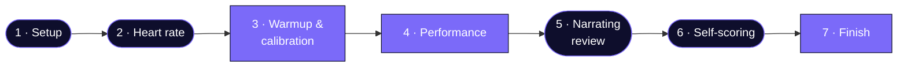

<p align="center">
  <picture>
    <source media="(prefers-color-scheme: dark)" srcset="assets/brand/readme-banner-dark.png">
    <source media="(prefers-color-scheme: light)" srcset="assets/brand/readme-banner-light.png">
    
  </picture>
</p>

<p align="center">
  <a href="https://github.com/CamHickling/Iris/actions/workflows/tests.yml"></a>
  <a href="LICENSE"></a>
  
  
</p>

<p align="center">
  <a href="#quick-start">Quick start</a> •
  <a href="#how-it-works">How it works</a> •
  <a href="#configuration">Configuration</a> •
  <a href="#documentation">Docs</a> •
  <a href="#contributing">Contributing</a>
</p>

---

Iris is a full-screen desktop app that runs structured, multi-phase lab sessions. It records USB webcams, GoPros, a Polar H10 heart-rate monitor, and a microphone from one place, and logs a shared timeline so you can line the data up afterwards.

It was built for Taekwondo performance research, where a participant performs, watches themselves back while narrating, and then scores their own performance. The phase system is configurable, so you can adapt it to other movement-science protocols.

## Features

- **One GUI for every device.** Overhead and face webcams, up to two GoPros over WiFi, a Polar H10 (HR, RR intervals, optional 130 Hz ECG), and a USB microphone.
- **Guided phase workflow.** The experimenter moves through phases, and checklists must be ticked before they can advance, so steps don't get skipped.
- **Built-in playback for participants.** Plays the overhead recording back while the face camera and mic record the participant's reaction. Pause/resume can be turned on per phase.
- **Synchronization manifest.** Every session writes a `sync_manifest.json` with microsecond Unix timestamps for each recording start/stop, phase change, and device event.
- **Automatic post-processing.** Uses ffmpeg to build a review video with the participant's commentary and face videos with a heart-rate overlay.
- **Calibration tools.** Intrinsic and extrinsic (stereo) checkerboard calibration, plus barrel-distortion correction for GoPro footage.
- **Live device status.** Pass/fail indicators for every connected device, and a pre-flight check (`--calibrate`).
- **Automatic backup.** When the experiment finishes, the session is copied to a backup drive.

## Quick start

**Prerequisites:** Windows 11, Python 3.9+, and [ffmpeg](https://ffmpeg.org/download.html) on your `PATH`.

```bash
git clone https://github.com/CamHickling/Iris.git
cd Iris
pip install -r requirements.txt
copy settings.example.json settings.json
python gui.py
```

You can also double-click `Iris.pyw` to launch without a console window, or use `launch.bat` to activate a conda environment first.

> **No hardware yet?** Leave GoPros, heart rate, and the microphone disabled in `settings.json`. Iris runs with just a webcam.

For full hardware setup (GoPro WiFi routing, Polar H10 pairing, camera indexing), see the **[Setup Guide](docs/SETUP_GUIDE.md)**.

## Command-line usage

```bash
python gui.py                          # Launch the GUI (recommended)
python main.py                         # Run an experiment headless with settings.json
python main.py --config custom.json    # Use a different config file
python main.py --calibrate             # Pre-flight device connectivity check
python main.py --undistort ./videos/   # Remove GoPro lens distortion from a file or folder
```

## Supported hardware

| Device | Qty | Connection | Used for |
|---|---|---|---|
| USB webcam, 1080p30 (tested: Logitech) | 2 | USB | Overhead + face camera |
| GoPro Hero 7 Silver / Hero 5 Session | 0–2 | WiFi (one USB WiFi adapter per camera) | Wide-angle multi-view capture |
| Polar H10 chest strap | 0–1 | Bluetooth LE | Heart rate, RR intervals, ECG |
| USB microphone (tested: Tonor) | 0–1 | USB | Narration and scoring audio |

Other OpenCV-compatible webcams and audio devices should work. Please [open an issue](https://github.com/CamHickling/Iris/issues) to report what you've tested.

## How it works

A session runs through these phases in order. Each phase `id` in `settings.json` maps to a handler in `src/experiment.py`.



<sub>Filled boxes are checklist-gated: Continue stays disabled until every item is ticked. Heart rate records continuously from phase 2 to 7.</sub>

| # | Phase (`id`) | What happens | Gated by checklist |
|---|---|---|---|
| 1 | Setup (`setup`) | Creates the session directory | — |
| 2 | Heart Rate Start (`heart_rate_start`) | Connects the Polar H10. HR records for the whole session. | — |
| 3 | Warmup & Calibration (`warmup_calibration`) | Opens cameras, assigns overhead/face roles, tests the mic, records GoPros during checkerboard calibration, T-pose, and clap sync | ✅ |
| 4 | Performance (`performance`) | Overhead camera + GoPros record the performance | ✅ |
| 5 | Narrating Review (`review`) | Participant watches the overhead video and narrates, with pause/resume. Face cam + mic record. | — |
| 6 | Self-Scoring (`scoring`) | Participant watches again (no pausing) and scores aloud. Face cam + mic record. | — |
| 7 | Finish (`finish`) | Stops HR, runs compositing and HR overlays, backs up the session | ✅ |

See [docs/EXPERIMENT_FLOW.md](docs/EXPERIMENT_FLOW.md) for the full lifecycle.

### Session output

```
Session_Name_20260222_143012/
├── sync_manifest.json            # Master timeline for all devices
├── performance/
│   └── overhead_camera.mp4
├── review/
│   ├── face_cam.mp4
│   ├── audio_commentary.wav
│   └── review_timestamps.json    # Pause/resume markers
├── scoring/
│   ├── face_cam.mp4
│   └── audio_scoring.wav
├── heart_rate/
│   ├── hr_full_session.csv       # BPM + RR intervals, labeled by phase
│   └── ecg_full_session.csv      # 130 Hz ECG (if enabled)
├── gopro_footage/                # GoPro files copied in after the session
├── composited/
│   ├── overhead_with_commentary.mp4
│   ├── review_face_with_hr.mp4
│   └── scoring_face_with_hr.mp4
└── calibration/
```

### Synchronization

All streams share one wall clock. `sync_manifest.json` records when each device actually started and stopped, so you can align HR to video, face cam to audio, and GoPros to the overhead camera after the session. [docs/SYNCHRONIZATION.md](docs/SYNCHRONIZATION.md) has the manifest format and alignment code examples.

## Configuration

Settings live in `settings.json`, which is git-ignored so each lab machine can keep its own copy. Start from [`settings.example.json`](settings.example.json). Most fields can also be edited in the GUI's **Devices**, **Phases**, and **Calibration** tabs.

| Section | Controls |
|---|---|
| `experiment` | Project name, output directory, recording format, `backup_dir` (set to `null` to turn off backup) |
| `cameras` | Device index, resolution, FPS, and role (`overhead` / `face`) for each webcam |
| `gopros` | Model, WiFi interface, IP, enabled flag |
| `heart_rate` | Polar H10 on/off, BLE address, ECG on/off |
| `microphone` | Device name/index, sample rate, channels |
| `calibration` | Checkerboard size, square size (mm), intrinsic/extrinsic toggles |
| `phases` | Ordered phase list: `id`, `name`, `instructions`, and capture flags (`record_video`, `record_audio`, `record_gopro`, `allow_pause`, `cameras`) |

A printable calibration target is in [docs/checkerboard.pdf](docs/checkerboard.pdf).

## Project structure

```
Iris/
├── gui.py                  # Desktop GUI (CustomTkinter), the main entry point
├── main.py                 # CLI entry point
├── Iris.pyw                # Windows double-click launcher
├── launch.bat              # Launcher that activates a conda env first
├── settings.example.json   # Template config; copy to settings.json
├── src/
│   ├── experiment.py       # Experiment state machine and phase handlers
│   ├── phase.py            # Phase model
│   ├── camera.py           # USB cameras (OpenCV)
│   ├── video_recorder.py   # Recording, including pausable recording
│   ├── video_player.py     # Threaded playback engine
│   ├── audio.py            # Microphone capture
│   ├── gopro.py            # GoPro WiFi control
│   ├── heart_rate.py       # Polar H10 over BLE
│   ├── compositing.py      # ffmpeg compositing and HR overlays
│   ├── calibrate.py        # Pre-flight device check
│   ├── intrinsic_calibration.py  # Checkerboard lens calibration
│   ├── extrinsic_calibration.py  # Multi-camera stereo calibration
│   ├── gopro_undistort.py  # GoPro barrel-distortion removal
│   └── utils.py
├── tests/                  # pytest suite (hardware is mocked)
├── scripts/
│   └── probe_camera.py     # List webcam resolutions/FPS
├── assets/                 # App icon; brand/ holds banners, logos, social preview
└── docs/                   # Setup, workflow, and sync guides
```

## Documentation

| Guide | Covers |
|---|---|
| [Setup Guide](docs/SETUP_GUIDE.md) | Hardware setup, drivers, GoPro WiFi routing, troubleshooting |
| [Experiment Flow](docs/EXPERIMENT_FLOW.md) | Phase lifecycle and handler details |
| [Synchronization](docs/SYNCHRONIZATION.md) | Manifest format and cross-device alignment recipes |
| [Experiment Specification](docs/experiment_specification.txt) | The original Taekwondo study protocol Iris was built for |

## Roadmap

- Post-session GoPro import with one-click intrinsic/extrinsic calibration
- Optional markerless motion-capture (pose estimation) pipeline on the calibrated footage

## Contributing

Contributions are welcome. See [CONTRIBUTING.md](CONTRIBUTING.md) for dev setup, running tests, and PR guidelines.

```bash
pip install -r requirements-dev.txt
python -m pytest
```

## Citation

If you use Iris in published research, please cite it. Citation metadata is in [CITATION.cff](CITATION.cff), and GitHub shows a "Cite this repository" button for it.

## License

Copyright 2026 Cam Hickling. Released under the [Apache License 2.0](LICENSE).

---

<p align="center">
  <br>
  <sub>Iris · built for movement science research</sub>
</p>
