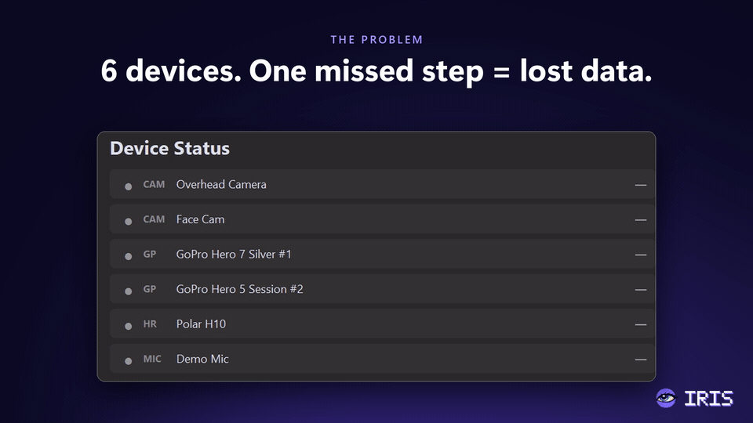
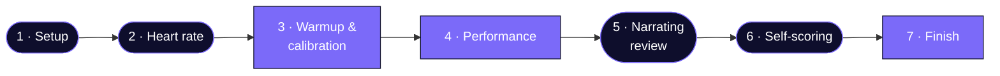

<p align="center">
  <picture>
    <source media="(prefers-color-scheme: dark)" srcset="assets/brand/readme-banner-dark.png">
    <source media="(prefers-color-scheme: light)" srcset="assets/brand/readme-banner-light.png">
    
  </picture>
</p>

<p align="center"><b>Run multi-sensor experiments from one screen, and walk away with data that lines up.</b></p>

<p align="center">
  <a href="video/iris-15s.mp4">
    
  </a>
</p>

<p align="center">
  <a href="https://github.com/CamHickling/Iris/actions/workflows/tests.yml"></a>
  <a href="LICENSE"></a>
  
  
</p>

<p align="center">
  <a href="#why-it-exists">Why it exists</a> •
  <a href="#quick-start">Quick start</a> •
  <a href="#how-it-works">How it works</a> •
  <a href="#status">Status</a> •
  <a href="#configuration">Configuration</a> •
  <a href="#documentation">Docs</a> •
  <a href="#credits">Credits</a>
</p>

---

**Who it's for.** Movement-science labs that record cameras, audio and heart rate in the same session. Iris guides the experimenter through each step so nothing gets missed, and logs every device on one shared clock so the data lines up afterwards. It was built for the UBC Brain, Attention and Reality Lab's Taekwondo flow study.

**What you get**

- **No skipped steps.** Each phase unlocks only when its checklist is done.
- **Data that lines up.** One `sync_manifest.json` per session logs every device on one clock, with millisecond timestamps.
- **One screen for six devices.** Webcams, GoPros, a Polar H10 and a microphone, each with a live status light.
- **Nothing lost.** Heavy processing waits until capture is over, and each session is copied to a backup drive when it ends.
- **Try it without hardware.** `python gui.py --demo` simulates every device.

**Track record:** 50 participants · 60+ trials · 1+ TB captured · zero lost sessions.

## Why it exists

**The problem.** The UBC Brain, Attention and Reality Lab's Taekwondo flow study needed overhead and face cameras, GoPros, heart rate and spoken narration recorded in one session, then lined up precisely for analysis. The team had no way to capture multimodal data like this and keep it in sync. Without a tool, the study couldn't run.

**Who used it.** A team of 10 researchers recorded 50 participants and more than 60 trials with Iris. The study is now in advanced analysis, ahead of writing and publication.

| Decision | Why |
|---|---|
| Checklists lock each phase until every item is ticked | Steps can't be skipped mid-session, when a participant can't redo a trial |
| One shared timeline for every device (`sync_manifest.json`, millisecond timestamps) | Alignment happens once, in software, not by hand for each trial |
| Sessions copied to a backup drive when they finish | A lost session is a lost participant |
| Runs with only a webcam; GoPros, heart rate and the microphone can each be turned off | New labs can try it before buying all the hardware |
| Phases configured in the app | Other movement-science protocols can use it without code changes |

**Impact.** No lost sessions across 50 participants. Together with [FlowAnalytics](https://github.com/CamHickling/FlowAnalytics), Iris cut out more than 90 hours of manual alignment. Its calibrated multi-camera footage made motion analysis possible, and its face recordings made facial analysis possible.

## Features

- **One GUI for every device.** Overhead and face webcams, up to two GoPros over WiFi, a Polar H10 (HR, RR intervals, optional 130 Hz ECG), and a USB microphone.
- **Guided phase workflow.** The experimenter moves through phases, and checklists must be ticked before they can advance, so steps don't get skipped.
- **Built-in playback for participants.** Plays the overhead recording back while the face camera and mic record the participant's reaction. Pause/resume can be turned on per phase.
- **Synchronization manifest.** Every session writes a `sync_manifest.json` with millisecond Unix timestamps for each recording start/stop, phase change, and device event.
- **Automatic post-processing.** Uses ffmpeg to build a review video with the participant's commentary and face videos with a heart-rate overlay.
- **Calibration tools.** Intrinsic and extrinsic (stereo) checkerboard calibration, plus barrel-distortion correction for GoPro footage.
- **Live device status.** Pass/fail indicators for every connected device, and a pre-flight check (`--calibrate`).
- **Automatic backup.** When the experiment finishes, the session is copied to a backup drive.

## Quick start

**Prerequisites:** Windows 11, Python 3.9+, and [ffmpeg](https://ffmpeg.org/download.html) on your `PATH`.

```bash
git clone https://github.com/CamHickling/Iris.git
cd Iris
pip install -r requirements.txt
copy settings.example.json settings.json
python gui.py
```

**Check that it worked:** run `python gui.py --demo`. Iris opens with simulated devices (nothing is written outside `demo_output/`). Click **Calibrate Devices** and all six device rows should turn green.

You can also double-click `Iris.pyw` to launch without a console window, or use `launch.bat` to activate a conda environment first.

> **No hardware yet?** Leave GoPros, heart rate, and the microphone disabled in `settings.json`. Iris runs with just a webcam.

For full hardware setup (GoPro WiFi routing, Polar H10 pairing, camera indexing), see the **[Setup Guide](docs/SETUP_GUIDE.md)**.

## Command-line usage

```bash
python gui.py                          # Launch the GUI (recommended)
python main.py                         # Run an experiment headless with settings.json
python main.py --config custom.json    # Use a different config file
python main.py --calibrate             # Pre-flight device connectivity check
python main.py --undistort ./videos/   # Remove GoPro lens distortion from a file or folder
```

## Supported hardware

| Device | Qty | Connection | Used for |
|---|---|---|---|
| USB webcam, 1080p30 (tested: Logitech) | 2 | USB | Overhead + face camera |
| GoPro Hero 7 Silver / Hero 5 Session | 0–2 | WiFi (one USB WiFi adapter per camera) | Wide-angle multi-view capture |
| Polar H10 chest strap | 0–1 | Bluetooth LE | Heart rate, RR intervals, ECG |
| USB microphone (tested: Tonor) | 0–1 | USB | Narration and scoring audio |

Other OpenCV-compatible webcams and audio devices should work. Please [open an issue](https://github.com/CamHickling/Iris/issues) to report what you've tested.

## How it works

A session runs through these phases in order. Each phase `id` in `settings.json` maps to a handler in `src/experiment.py`.



<sub>Filled boxes are checklist-gated: Continue stays disabled until every item is ticked. Heart rate records continuously from phase 2 to 7.</sub>

| # | Phase (`id`) | What happens | Gated by checklist |
|---|---|---|---|
| 1 | Setup (`setup`) | Creates the session directory | — |
| 2 | Heart Rate Start (`heart_rate_start`) | Connects the Polar H10. HR records for the whole session. | — |
| 3 | Warmup & Calibration (`warmup_calibration`) | Opens cameras, assigns overhead/face roles, tests the mic, records GoPros during checkerboard calibration, T-pose, and clap sync | ✅ |
| 4 | Performance (`performance`) | Overhead camera + GoPros record the performance | ✅ |
| 5 | Narrating Review (`review`) | Participant watches the overhead video and narrates, with pause/resume. Face cam + mic record. | — |
| 6 | Self-Scoring (`scoring`) | Participant watches again (no pausing) and scores aloud. Face cam + mic record. | — |
| 7 | Finish (`finish`) | Stops HR, runs compositing and HR overlays, backs up the session | ✅ |

See [docs/EXPERIMENT_FLOW.md](docs/EXPERIMENT_FLOW.md) for the full lifecycle.

### Session output

```
Session_Name_20260222_143012/
├── sync_manifest.json            # Master timeline for all devices
├── performance/
│   └── overhead_camera.mp4
├── review/
│   ├── face_cam.mp4
│   ├── audio_commentary.wav
│   └── review_timestamps.json    # Pause/resume markers
├── scoring/
│   ├── face_cam.mp4
│   └── audio_scoring.wav
├── heart_rate/
│   ├── hr_full_session.csv       # BPM + RR intervals, labeled by phase
│   └── ecg_full_session.csv      # 130 Hz ECG (if enabled)
├── gopro_footage/                # GoPro files copied in after the session
├── composited/
│   ├── overhead_with_commentary.mp4
│   ├── review_face_with_hr.mp4
│   └── scoring_face_with_hr.mp4
└── calibration/
```

### Synchronization

All streams share one wall clock. `sync_manifest.json` records when each device actually started and stopped, so you can align HR to video, face cam to audio, and GoPros to the overhead camera after the session. [docs/SYNCHRONIZATION.md](docs/SYNCHRONIZATION.md) has the manifest format and alignment code examples.

## Configuration

Settings live in `settings.json`, which is git-ignored so each lab machine can keep its own copy. Start from [`settings.example.json`](settings.example.json). Most fields can also be edited in the GUI's **Devices**, **Phases**, and **Calibration** tabs.

| Section | Controls |
|---|---|
| `experiment` | Project name, output directory, recording format, `backup_dir` (set to `null` to turn off backup) |
| `cameras` | Device index, resolution, FPS, and role (`overhead` / `face`) for each webcam |
| `gopros` | Model, WiFi interface, IP, enabled flag |
| `heart_rate` | Polar H10 on/off, BLE address, ECG on/off |
| `microphone` | Device name/index, sample rate, channels |
| `calibration` | Checkerboard size, square size (mm), intrinsic/extrinsic toggles |
| `phases` | Ordered phase list: `id`, `name`, `instructions`, and capture flags (`record_video`, `record_audio`, `record_gopro`, `allow_pause`, `cameras`) |

A printable calibration target is in [docs/checkerboard.pdf](docs/checkerboard.pdf).

## Project structure

```
Iris/
├── gui.py                  # Desktop GUI (CustomTkinter), the main entry point
├── main.py                 # CLI entry point
├── Iris.pyw                # Windows double-click launcher
├── launch.bat              # Launcher that activates a conda env first
├── settings.example.json   # Template config; copy to settings.json
├── src/
│   ├── experiment.py       # Experiment state machine and phase handlers
│   ├── phase.py            # Phase model
│   ├── camera.py           # USB cameras (OpenCV)
│   ├── video_recorder.py   # Recording, including pausable recording
│   ├── video_player.py     # Threaded playback engine
│   ├── audio.py            # Microphone capture
│   ├── gopro.py            # GoPro WiFi control
│   ├── heart_rate.py       # Polar H10 over BLE
│   ├── compositing.py      # ffmpeg compositing and HR overlays
│   ├── calibrate.py        # Pre-flight device check
│   ├── intrinsic_calibration.py  # Checkerboard lens calibration
│   ├── extrinsic_calibration.py  # Multi-camera stereo calibration
│   ├── gopro_undistort.py  # GoPro barrel-distortion removal
│   └── utils.py
├── tests/                  # pytest suite (hardware is mocked)
├── scripts/
│   └── probe_camera.py     # List webcam resolutions/FPS
├── assets/                 # App icon; brand/ holds banners, logos, social preview
└── docs/                   # Setup, workflow, and sync guides
```

## Documentation

| Guide | Covers |
|---|---|
| [Setup Guide](docs/SETUP_GUIDE.md) | Hardware setup, drivers, GoPro WiFi routing, troubleshooting |
| [Experiment Flow](docs/EXPERIMENT_FLOW.md) | Phase lifecycle and handler details |
| [Synchronization](docs/SYNCHRONIZATION.md) | Manifest format and cross-device alignment recipes |
| [Experiment Specification](docs/experiment_specification.txt) | The original Taekwondo study protocol Iris was built for |

## Status

| Part | Status |
|---|---|
| Guided 7-phase workflow with checklist-gated phases | ✅ Working, used for every session of the study |
| Capture: webcams, GoPros over WiFi, Polar H10 (HR, RR, ECG), microphone | ✅ Working |
| `sync_manifest.json` shared timeline (millisecond timestamps) | ✅ Working |
| Post-session compositing and heart-rate overlays | ✅ Working |
| Automatic backup, pre-flight device check, checkerboard calibration tools | ✅ Working |
| Demo mode with simulated devices (`--demo`) | ✅ Working |
| Review player at 1920x1080: the video can push Pause/Continue off screen (the spacebar still works) | 🟡 Known issue |
| Post-session GoPro import with one-click intrinsic/extrinsic calibration | ⏳ Planned |
| Markerless motion capture (pose estimation) on the calibrated footage | ⏳ Planned |

## Contributing

Contributions are welcome. See [CONTRIBUTING.md](CONTRIBUTING.md) for dev setup, running tests, and PR guidelines.

```bash
pip install -r requirements-dev.txt
python -m pytest
```

## Credits

Built by [Cam Hickling](https://github.com/CamHickling) in collaboration with Alan Kingstone, Angela Mejia, Baruch Eitam and the research assistants of the UBC Brain, Attention and Reality (BAR) Lab. [FlowAnalytics](https://github.com/CamHickling/FlowAnalytics) processes the recordings Iris makes.

## Ethics and data

No participant data, faces, voices or names are in this repository, its screenshots or the demo GIF. The demo was recorded with `--demo`, which simulates every device. Iris writes sessions outside the repository, and `settings.json`, `output/` and `demo_output/` are git-ignored. Getting consent and storing data as your ethics approval requires is the researcher's responsibility.

## Citation

If you use Iris in published research, please cite it. Citation metadata is in [CITATION.cff](CITATION.cff), and GitHub shows a "Cite this repository" button for it.

## License

Copyright 2026 Cam Hickling. Released under the [Apache License 2.0](LICENSE).

---

<p align="center">
  <br>
  <sub>Iris · built for movement science research</sub>
</p>
